# 基于微信小程序的高校餐厅食品留样管理系统

> 🎓 **计算机毕业设计 · 基于微信小程序的高校餐厅食品留样管理系统**
>
> 本仓库只放**项目介绍 + 运行截图**（截图是站点带水印的原图，存在仓库 `images/` 里）。
>
> 👉 **完整可运行源码 / 数据库脚本 / 部署文档：[点我获取](https://geekcode.top/archives/%E5%9F%BA%E4%BA%8E%E5%BE%AE%E4%BF%A1%E5%B0%8F%E7%A8%8B%E5%BA%8F%E7%9A%84%E9%AB%98%E6%A0%A1%E9%A4%90%E5%8E%85%E9%A3%9F%E5%93%81%E7%95%99%E6%A0%B7%E7%AE%A1%E7%90%86%E7%B3%BB%E7%BB%9F?utm_source=github)**
>
> 💬 咨询微信：**ir9372**　|　🌐 更多项目：[极客代码 geekcode.top](https://geekcode.top/?utm_source=github)
>
> 📌 项目详情页：<https://geekcode.top/archives/%E5%9F%BA%E4%BA%8E%E5%BE%AE%E4%BF%A1%E5%B0%8F%E7%A8%8B%E5%BA%8F%E7%9A%84%E9%AB%98%E6%A0%A1%E9%A4%90%E5%8E%85%E9%A3%9F%E5%93%81%E7%95%99%E6%A0%B7%E7%AE%A1%E7%90%86%E7%B3%BB%E7%BB%9F?utm_source=github>

<table><td width="230" align="center"> <b>扫码加微信 ir9372</b></td><td valign="middle">📦 源码 = 项目介绍 + 全部运行截图 + 数据库 + 部署文档 👉 点上方任意截图，直接跳到 <b>极客代码 geekcode.top</b> 详情页</td></table>

---

<h1>基于微信小程序的高校餐厅食品留样管理系统</h1>
<h2>项目概述</h2>

本项目为“基于微信小程序的高校餐厅食品留样管理系统”，旨在通过数字化手段规范高校食堂的食品留样管理流程，保障师生饮食安全。系统采用前后端分离架构，后端基于 Java Spring Boot 框构建，前端包含 Web 管理后台及微信小程序用户端。核心功能涵盖留样食品记录、销毁处理、排班信息管理、窗口人员配置、教育宣传发布及处罚公告展示等模块。适用人群包括高校后勤管理人员、食堂窗口负责人、普通师生及监管人员。系统通过小程序实现移动化便捷操作，结合 Web 后台进行数据集中管理与权限控制，有效解决了传统纸质记录易丢失、查询效率低及监管滞后等问题，提升了食品安全管理的透明度与响应速度。

<h2>技术架构</h2>

本系统采用典型的 B/S（浏览器/服务器）与 C/S（客户端/服务器）混合架构模式，具体分为微信小程序前端、Web 管理后台前端以及 Java 后端服务三部分。

<strong>1. 后端架构</strong>
后端服务基于 Spring Boot 框架开发，利用其自动配置特性快速搭建应用基础。持久层采用 MyBatis-Plus 框架，简化了单表 CRUD 操作并支持复杂 SQL 查询。数据库选用 MySQL，负责存储用户信息、留样记录、排班数据等业务信息。安全认证与授权机制引入 Apache Shiro，用于管理后台管理员及小程序用户的登录状态与会话控制。RESTful API 风格接口设计确保了前后端数据交互的规范性与无状态性。

<strong>2. 前端架构</strong>

<ul>
<li><strong>Web 管理后台</strong>：作为主要的数据录入与管理入口，面向行政管理人员。通过 HTTP 请求调用后端 Controller 提供的接口，实现数据的增删改查及报表展示。</li>
<li><strong>微信小程序前端</strong>：面向广大师生及食堂工作人员。利用微信原生能力或 Vue 集成方案（根据项目类型 vue-integrated 推断），通过 <code>wx.request</code> 或类似网络库向后端发起 REST API 请求。小程序端重点优化了移动端交互体验，如列表下拉刷新、详情页面跳转及图片上传等功能。</li>
</ul>

<strong>3. 交互方式</strong>
前后端完全解耦，所有业务逻辑均在后端完成。小程序和 Web 后台仅负责视图渲染与用户输入收集。双方通过 JSON 格式数据进行通信，后端 Controller 层接收请求参数，经过 Service 层业务处理后，由 Mapper 层访问数据库，最终将结果封装返回给前端。这种架构便于系统扩展与维护，同时保证了数据的一致性与安全性。

<h2>功能模块</h2>

根据源码中的 Controller 列表、路由配置及截图功能点，系统主要划分为以下两大终端的功能模块：

<h3>1. 微信小程序用户端</h3>

小程序端主要服务于普通用户查看信息及特定角色进行操作，具体功能如下：

<ul>
<li><strong>用户中心模块</strong>：</li>
<li><strong>登录/注册/忘记密码</strong>：提供账号身份验证入口，支持新用户注册及密码找回。</li>
<li><strong>个人信息管理</strong>：允许用户查看及修改基本个人资料。</li>
<li><strong>“我的”页面</strong>：聚合个人相关设置与快捷入口。</li>
<li><strong>信息查询与展示模块</strong>：</li>
<li><strong>首页</strong>：展示系统关键入口或最新公告。</li>
<li><strong>冰柜管理</strong>：查看冰柜列表及冰柜详细信息，监控留样存储空间状态。</li>
<li><strong>留样食品</strong>：浏览留样食品列表，查看具体食品的留样详情（如名称、时间、责任人等）。</li>
<li><strong>留样食品销毁</strong>：查看已销毁食品的记录列表及销毁详情，确保留样闭环管理。</li>
<li><strong>排班信息</strong>：查看食堂各窗口的员工排班列表及详细排班情况。</li>
<li><strong>窗口员工</strong>：浏览窗口员工列表，查看员工详细信息。</li>
<li><strong>教育宣传</strong>：阅读食品安全相关的教育宣传文章，查看宣传详情。</li>
<li><strong>处罚公告</strong>：查看违规处罚公告列表及公告具体内容，起到警示作用。</li>
<li><strong>管理辅助模块</strong>（针对特定权限用户）：</li>
<li><strong>窗口负责人管理</strong>：在小程序内提供窗口负责人列表及详情查看功能，可能涉及部分轻量级管理操作。</li>
</ul>
<h3>2. Web 后台管理端</h3>

后台端面向系统管理员，提供全面的数据维护与配置功能，对应路由 <code>/liuyangshipinxiaohui</code>, <code>/jiaoyuxuanchuan</code>, <code>/chuangkoufuzeren</code>, <code>/paibanxinxi</code>, <code>/liuyangshipin</code>, <code>/chufagonggao</code>, <code>/chuangkouyuangong</code>, <code>/bingju</code>, <code>/config</code>：

<ul>
<li><strong>系统登录</strong>：管理员专属登录界面，验证身份后进入后台主页。</li>
<li><strong>留样食品管理</strong> (<code>LiuyangshipinController</code>)：对留样食品数据进行全生命周期管理，包括新增、编辑、删除及查询。</li>
<li><strong>留样食品销毁管理</strong> (<code>LiuyangshipinxiaohuiController</code>)：记录并管理食品销毁流程，关联留样记录，生成销毁凭证。</li>
<li><strong>排班信息管理</strong> (<code>PaibanxinxiController</code>)：制定、调整及审核食堂员工的排班计划，确保人力合理分配。</li>
<li><strong>窗口负责人管理</strong> (<code>ChuangkoufuzerenController</code>)：维护各餐饮窗口的负责人信息，明确责任主体。</li>
<li><strong>窗口员工管理</strong> (<code>ChuangkouyuangongController</code>)：录入及管理食堂一线员工的基本档案与岗位信息。</li>
<li><strong>冰柜管理</strong> (<code>BingjuController</code>)：配置与维护留样冰柜的设备信息，如编号、位置、容量等。</li>
<li><strong>教育宣传管理</strong> (<code>JiaoyuxuanchuanController</code>)：发布食品安全知识、政策法规等宣传内容，供前端展示。</li>
<li><strong>处罚公告管理</strong> (<code>ChufagonggaoController</code>)：发布针对违规行为的处罚通报，强化制度执行力。</li>
<li><strong>系统配置</strong> (<code>ConfigController</code>)：管理系统基础参数、字典值或其他全局配置项。</li>
<li><strong>通用文件服务</strong> (<code>FileController</code>)：处理图片、文档等文件的上传与下载，支撑上述模块的多媒体需求。</li>
</ul>
<h2>用户角色与权限</h2>

系统基于 Shiro 框架实现细粒度的权限控制，主要划分为以下两类角色：

<strong>1. 超级管理员 (Admin)</strong>

<ul>
<li><strong>访问范围</strong>：Web 后台管理端 + 微信小程序（具备最高权限视角）。</li>
<li><strong>权限描述</strong>：拥有系统所有功能的读写权限。可以管理用户账号、配置系统参数、发布公告、审核排班、录入留样与销毁记录、维护员工与负责人信息等。是系统的核心运营者，负责数据的完整性与安全性。</li>
</ul>

<strong>2. 普通用户 / 食堂相关人员</strong>

<ul>
<li><strong>访问范围</strong>：微信小程序用户端。</li>
<li><strong>权限描述</strong>：</li>
<li><strong>浏览权限</strong>：可自由查看首页、教育宣传、处罚公告、冰柜状态、留样食品列表及详情、排班信息、窗口员工信息等公开数据。</li>
<li><strong>个人权限</strong>：仅限管理自己的个人信息（如修改头像、昵称等）。</li>
<li><strong>受限操作</strong>：通常不具备直接修改后台核心业务数据（如删除留样记录、更改他人排班）的权限，除非被赋予特定的子角色（如窗口负责人可能在小程序端有有限的确认或上报权限，但主要数据维护仍依赖后台）。</li>
</ul>

<strong>权限隔离机制</strong>：
Web 后台通过 URL 拦截器保护，未登录或非 Admin 角色无法访问 <code>/admin</code> 相关路由。小程序端通过 Token 验证用户身份，不同角色的用户登录后，小程序界面会根据权限动态显示或隐藏“管理端-窗口负责人”等高级入口，确保数据访问的安全性。

<h2>项目特色与创新点</h2>

<strong>1. 移动端优先的食品安全监管</strong>
区别于传统的 PC 端管理系统，本项目深度整合微信小程序，使得食堂工作人员和管理者能够随时随地通过手机查看留样状态、排班情况及公告信息。特别是在“留样食品”与“冰柜”模块中，移动端的便捷性有助于提高现场记录的及时性和准确性，减少人为疏漏。

<strong>2. 全流程闭环管理</strong>
系统不仅关注“留样”这一静态环节，还引入了“留样食品销毁”模块，形成了从“入库留样”到“期满销毁”的完整证据链。结合“处罚公告”和“教育宣传”，构建了“预防-执行-监督-惩处”的管理闭环，强化了高校餐厅的合规性意识。

<strong>3. 多维度的信息透明化</strong>
通过小程序向师生公开“排班信息”、“窗口员工”及“冰柜”状态，打破了食堂内部管理的黑箱效应。这种透明化机制增强了师生对食堂卫生的信任感，同时也倒逼食堂工作人员严格遵守操作规范。

<strong>4. 轻量化且稳定的技术选型</strong>
采用 Spring Boot + MyBatis-Plus + Shiro 的经典组合，既保证了后端服务的稳定性与高并发处理能力，又通过 MyBatis-Plus 大幅减少了样板代码，提高了开发效率。前端使用 Vue 集成的小程序方案，兼顾了开发速度与用户体验，适合高校场景下的快速部署与维护。

<h2>部署环境</h2>

为确保系统正常运行，需准备以下软件及硬件环境：

<strong>1. 服务端环境</strong>

<ul>
<li><strong>操作系统</strong>：Linux (CentOS 7+/Ubuntu 20.04+) 或 Windows Server。</li>
<li><strong>Java 运行环境</strong>：JDK 1.8 及以上版本。</li>
<li><strong>数据库</strong>：MySQL 5.7 或 8.0 版本，需启用 InnoDB 引擎以支持事务。</li>
<li><strong>Web 容器</strong>：内置 Tomcat（Spring Boot 自带）或独立 Nginx 用于反向代理及静态资源托管。</li>
</ul>

<strong>2. 前端开发环境</strong>

<ul>
<li><strong>Node.js</strong>：建议版本 v12.0+，用于编译 Vue 项目及小程序相关依赖。</li>
<li><strong>包管理器</strong>：npm 或 yarn。</li>
<li><strong>IDE</strong>：Visual Studio Code 或 IntelliJ IDEA。</li>
</ul>

<strong>3. 微信小程序环境</strong>

<ul>
<li><strong>开发工具</strong>：微信开发者工具（WeChat DevTools）。</li>
<li><strong>AppID</strong>：需在微信公众平台申请的小程序 AppID。</li>
<li><strong>真机调试</strong>：支持 iOS 和 Android 系统的智能手机，安装微信客户端。</li>
</ul>

<strong>4. 网络与安全</strong>

<ul>
<li><strong>域名配置</strong>：小程序要求 HTTPS 协议，需配置 SSL 证书。</li>
<li><strong>白名单</strong>：在后端防火墙或云服务商安全组中开放必要端口（如 80, 443, 3306 等，注意数据库端口不对外公网开放）。</li>
</ul>
<h2>五、技术特性</h2>
<ul>
<li>前后端集成部署，前端资源打包至后端 static 目录</li>
<li>使用 MyBatis-Plus 简化数据访问层开发</li>
<li>集成 Shiro 权限框架实现角色权限控制</li>
</ul>
<h2>六、功能模块截图</h2>
<h3>微信小程序用户端</h3>

<figure><a href="https://geekcode.top/archives/%E5%9F%BA%E4%BA%8E%E5%BE%AE%E4%BF%A1%E5%B0%8F%E7%A8%8B%E5%BA%8F%E7%9A%84%E9%AB%98%E6%A0%A1%E9%A4%90%E5%8E%85%E9%A3%9F%E5%93%81%E7%95%99%E6%A0%B7%E7%AE%A1%E7%90%86%E7%B3%BB%E7%BB%9F?utm_source=github" title="查看完整源码">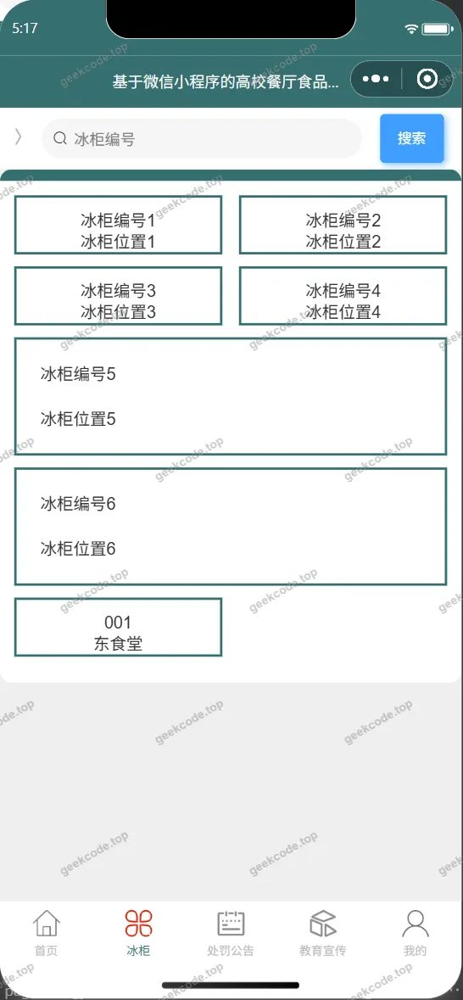</a><figcaption>小程序-冰柜</figcaption></figure>
<figure><a href="https://geekcode.top/archives/%E5%9F%BA%E4%BA%8E%E5%BE%AE%E4%BF%A1%E5%B0%8F%E7%A8%8B%E5%BA%8F%E7%9A%84%E9%AB%98%E6%A0%A1%E9%A4%90%E5%8E%85%E9%A3%9F%E5%93%81%E7%95%99%E6%A0%B7%E7%AE%A1%E7%90%86%E7%B3%BB%E7%BB%9F?utm_source=github" title="查看完整源码">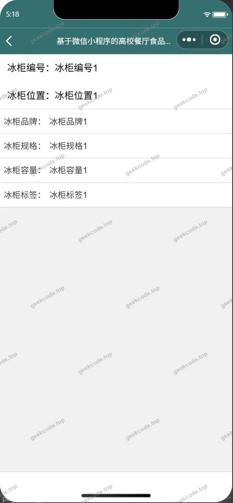</a><figcaption>小程序-冰柜详情</figcaption></figure>
<figure><a href="https://geekcode.top/archives/%E5%9F%BA%E4%BA%8E%E5%BE%AE%E4%BF%A1%E5%B0%8F%E7%A8%8B%E5%BA%8F%E7%9A%84%E9%AB%98%E6%A0%A1%E9%A4%90%E5%8E%85%E9%A3%9F%E5%93%81%E7%95%99%E6%A0%B7%E7%AE%A1%E7%90%86%E7%B3%BB%E7%BB%9F?utm_source=github" title="查看完整源码">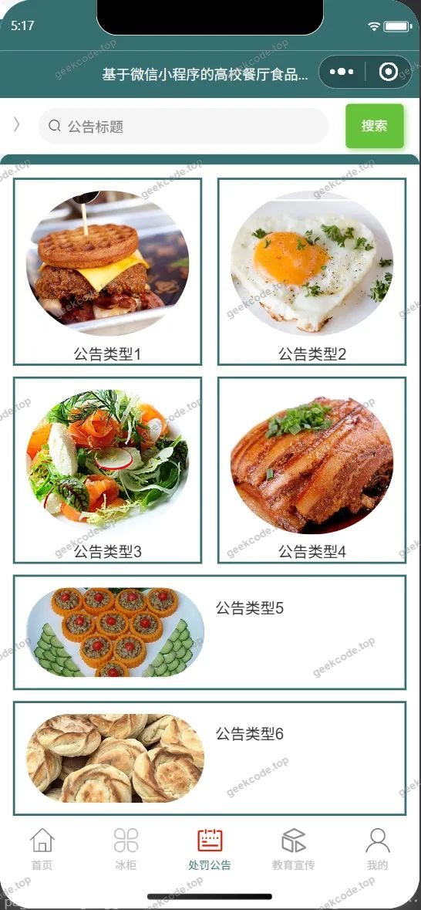</a><figcaption>小程序-处罚公告</figcaption></figure>
<figure><a href="https://geekcode.top/archives/%E5%9F%BA%E4%BA%8E%E5%BE%AE%E4%BF%A1%E5%B0%8F%E7%A8%8B%E5%BA%8F%E7%9A%84%E9%AB%98%E6%A0%A1%E9%A4%90%E5%8E%85%E9%A3%9F%E5%93%81%E7%95%99%E6%A0%B7%E7%AE%A1%E7%90%86%E7%B3%BB%E7%BB%9F?utm_source=github" title="查看完整源码">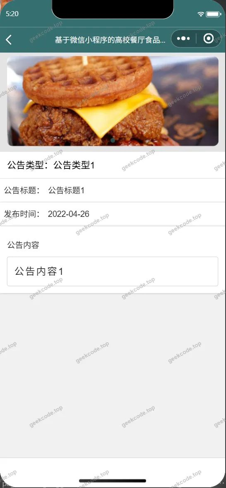</a><figcaption>小程序-处罚公告详情</figcaption></figure>
<figure><figcaption>小程序-窗口员工列表</figcaption></figure>
<figure><a href="https://geekcode.top/archives/%E5%9F%BA%E4%BA%8E%E5%BE%AE%E4%BF%A1%E5%B0%8F%E7%A8%8B%E5%BA%8F%E7%9A%84%E9%AB%98%E6%A0%A1%E9%A4%90%E5%8E%85%E9%A3%9F%E5%93%81%E7%95%99%E6%A0%B7%E7%AE%A1%E7%90%86%E7%B3%BB%E7%BB%9F?utm_source=github" title="查看完整源码">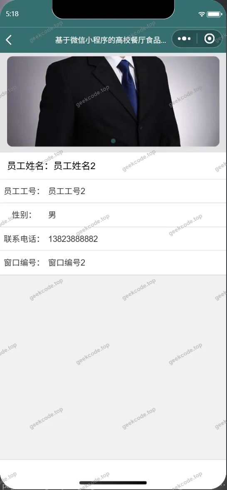</a><figcaption>小程序-窗口员工详情</figcaption></figure>
<figure><a href="https://geekcode.top/archives/%E5%9F%BA%E4%BA%8E%E5%BE%AE%E4%BF%A1%E5%B0%8F%E7%A8%8B%E5%BA%8F%E7%9A%84%E9%AB%98%E6%A0%A1%E9%A4%90%E5%8E%85%E9%A3%9F%E5%93%81%E7%95%99%E6%A0%B7%E7%AE%A1%E7%90%86%E7%B3%BB%E7%BB%9F?utm_source=github" title="查看完整源码">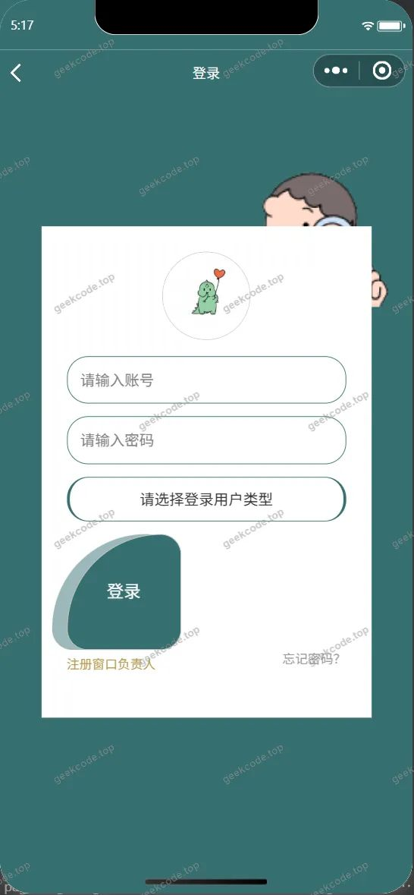</a><figcaption>小程序-登录</figcaption></figure>
<figure><a href="https://geekcode.top/archives/%E5%9F%BA%E4%BA%8E%E5%BE%AE%E4%BF%A1%E5%B0%8F%E7%A8%8B%E5%BA%8F%E7%9A%84%E9%AB%98%E6%A0%A1%E9%A4%90%E5%8E%85%E9%A3%9F%E5%93%81%E7%95%99%E6%A0%B7%E7%AE%A1%E7%90%86%E7%B3%BB%E7%BB%9F?utm_source=github" title="查看完整源码">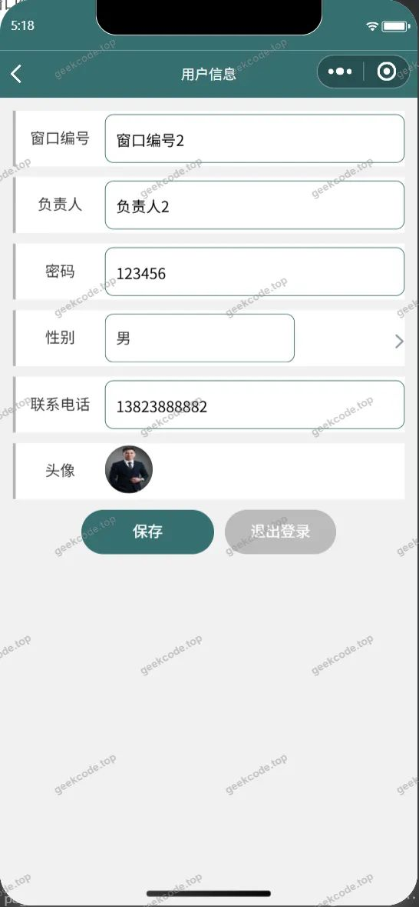</a><figcaption>小程序-个人信息</figcaption></figure>
<figure><a href="https://geekcode.top/archives/%E5%9F%BA%E4%BA%8E%E5%BE%AE%E4%BF%A1%E5%B0%8F%E7%A8%8B%E5%BA%8F%E7%9A%84%E9%AB%98%E6%A0%A1%E9%A4%90%E5%8E%85%E9%A3%9F%E5%93%81%E7%95%99%E6%A0%B7%E7%AE%A1%E7%90%86%E7%B3%BB%E7%BB%9F?utm_source=github" title="查看完整源码">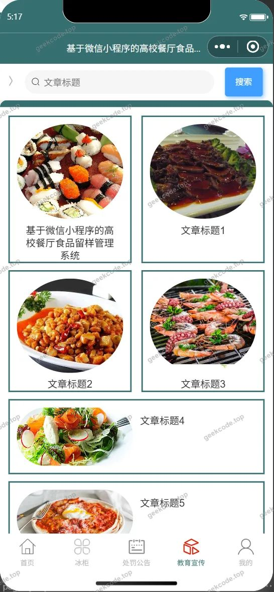</a><figcaption>小程序-教育宣传</figcaption></figure>
<figure><a href="https://geekcode.top/archives/%E5%9F%BA%E4%BA%8E%E5%BE%AE%E4%BF%A1%E5%B0%8F%E7%A8%8B%E5%BA%8F%E7%9A%84%E9%AB%98%E6%A0%A1%E9%A4%90%E5%8E%85%E9%A3%9F%E5%93%81%E7%95%99%E6%A0%B7%E7%AE%A1%E7%90%86%E7%B3%BB%E7%BB%9F?utm_source=github" title="查看完整源码">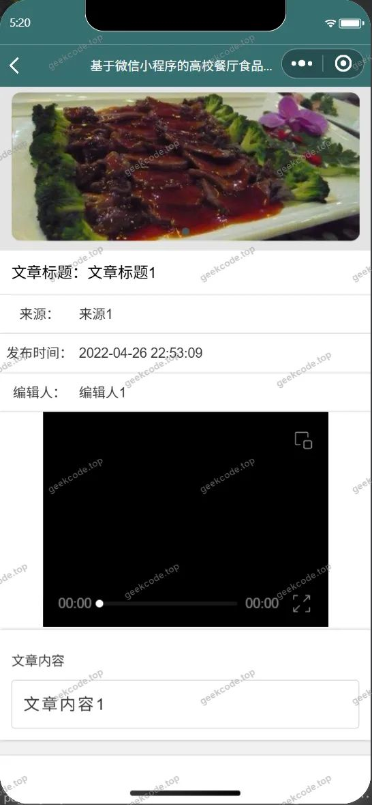</a><figcaption>小程序-教育宣传详情</figcaption></figure>
<figure><a href="https://geekcode.top/archives/%E5%9F%BA%E4%BA%8E%E5%BE%AE%E4%BF%A1%E5%B0%8F%E7%A8%8B%E5%BA%8F%E7%9A%84%E9%AB%98%E6%A0%A1%E9%A4%90%E5%8E%85%E9%A3%9F%E5%93%81%E7%95%99%E6%A0%B7%E7%AE%A1%E7%90%86%E7%B3%BB%E7%BB%9F?utm_source=github" title="查看完整源码">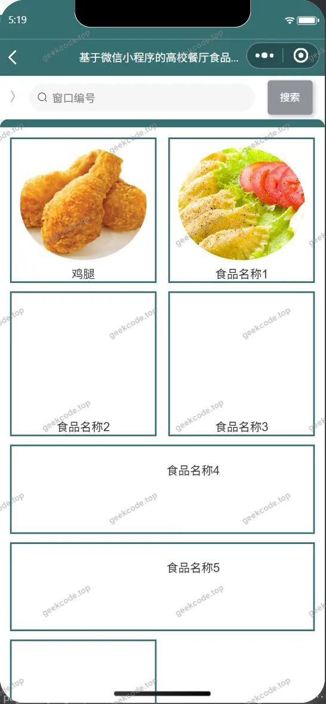</a><figcaption>小程序-留样食品列表</figcaption></figure>
<figure><a href="https://geekcode.top/archives/%E5%9F%BA%E4%BA%8E%E5%BE%AE%E4%BF%A1%E5%B0%8F%E7%A8%8B%E5%BA%8F%E7%9A%84%E9%AB%98%E6%A0%A1%E9%A4%90%E5%8E%85%E9%A3%9F%E5%93%81%E7%95%99%E6%A0%B7%E7%AE%A1%E7%90%86%E7%B3%BB%E7%BB%9F?utm_source=github" title="查看完整源码">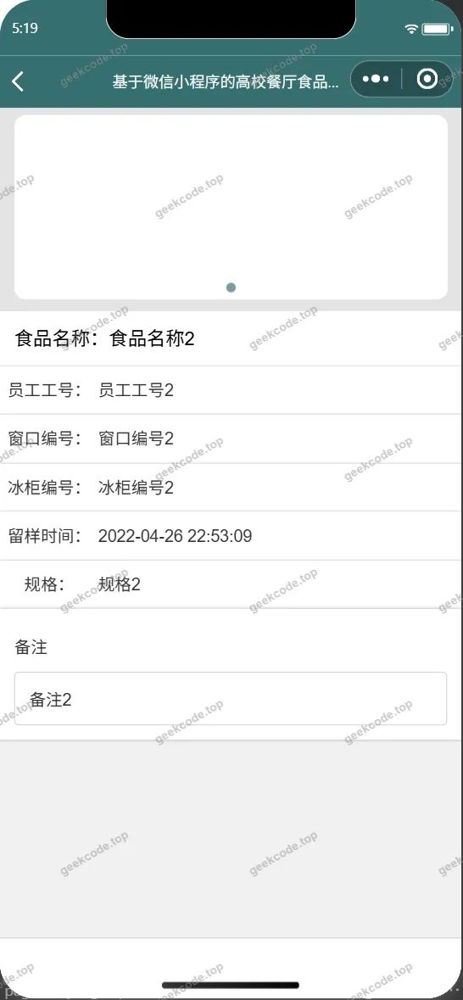</a><figcaption>小程序-留样食品详情</figcaption></figure>
<figure><a href="https://geekcode.top/archives/%E5%9F%BA%E4%BA%8E%E5%BE%AE%E4%BF%A1%E5%B0%8F%E7%A8%8B%E5%BA%8F%E7%9A%84%E9%AB%98%E6%A0%A1%E9%A4%90%E5%8E%85%E9%A3%9F%E5%93%81%E7%95%99%E6%A0%B7%E7%AE%A1%E7%90%86%E7%B3%BB%E7%BB%9F?utm_source=github" title="查看完整源码">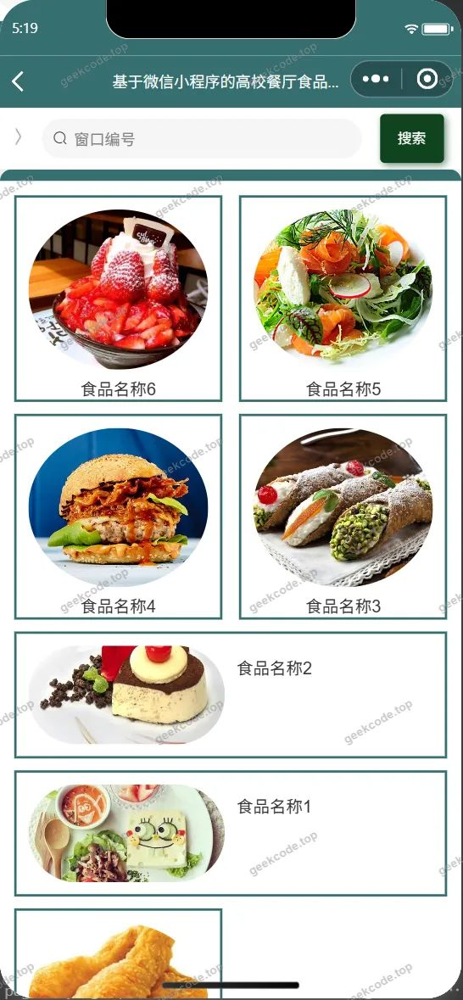</a><figcaption>小程序-留样食品销毁列表</figcaption></figure>
<figure><a href="https://geekcode.top/archives/%E5%9F%BA%E4%BA%8E%E5%BE%AE%E4%BF%A1%E5%B0%8F%E7%A8%8B%E5%BA%8F%E7%9A%84%E9%AB%98%E6%A0%A1%E9%A4%90%E5%8E%85%E9%A3%9F%E5%93%81%E7%95%99%E6%A0%B7%E7%AE%A1%E7%90%86%E7%B3%BB%E7%BB%9F?utm_source=github" title="查看完整源码">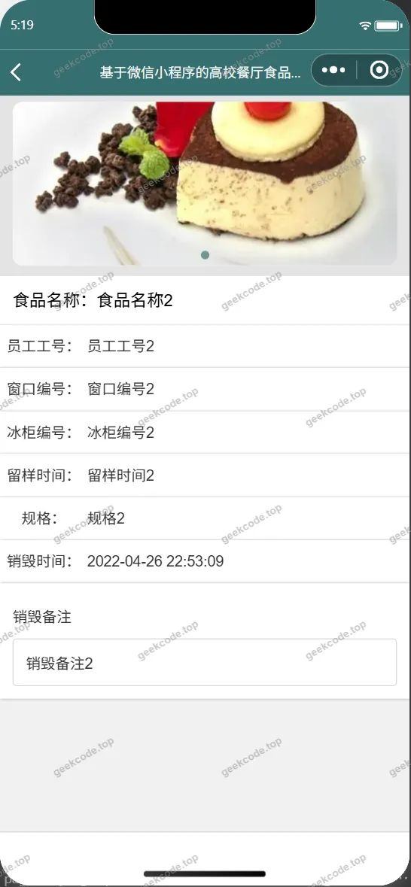</a><figcaption>小程序-留样食品销毁详情</figcaption></figure>
<figure><a href="https://geekcode.top/archives/%E5%9F%BA%E4%BA%8E%E5%BE%AE%E4%BF%A1%E5%B0%8F%E7%A8%8B%E5%BA%8F%E7%9A%84%E9%AB%98%E6%A0%A1%E9%A4%90%E5%8E%85%E9%A3%9F%E5%93%81%E7%95%99%E6%A0%B7%E7%AE%A1%E7%90%86%E7%B3%BB%E7%BB%9F?utm_source=github" title="查看完整源码">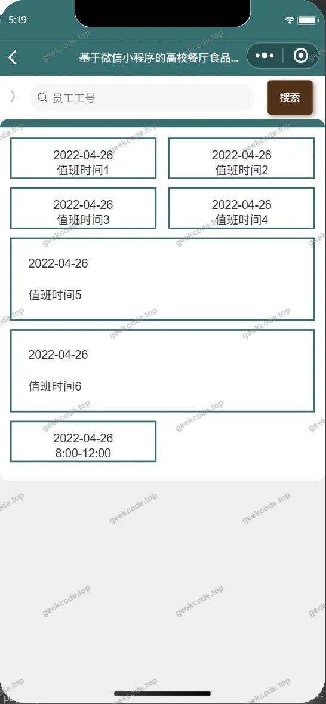</a><figcaption>小程序-排班信息列表</figcaption></figure>
<figure><a href="https://geekcode.top/archives/%E5%9F%BA%E4%BA%8E%E5%BE%AE%E4%BF%A1%E5%B0%8F%E7%A8%8B%E5%BA%8F%E7%9A%84%E9%AB%98%E6%A0%A1%E9%A4%90%E5%8E%85%E9%A3%9F%E5%93%81%E7%95%99%E6%A0%B7%E7%AE%A1%E7%90%86%E7%B3%BB%E7%BB%9F?utm_source=github" title="查看完整源码">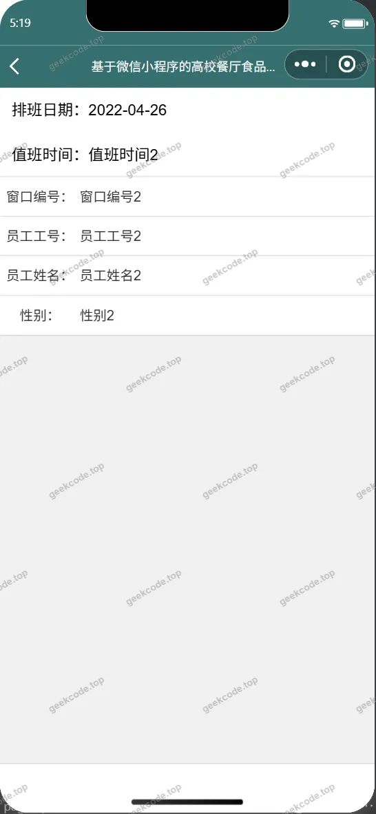</a><figcaption>小程序-排班信息详情</figcaption></figure>
<figure><a href="https://geekcode.top/archives/%E5%9F%BA%E4%BA%8E%E5%BE%AE%E4%BF%A1%E5%B0%8F%E7%A8%8B%E5%BA%8F%E7%9A%84%E9%AB%98%E6%A0%A1%E9%A4%90%E5%8E%85%E9%A3%9F%E5%93%81%E7%95%99%E6%A0%B7%E7%AE%A1%E7%90%86%E7%B3%BB%E7%BB%9F?utm_source=github" title="查看完整源码">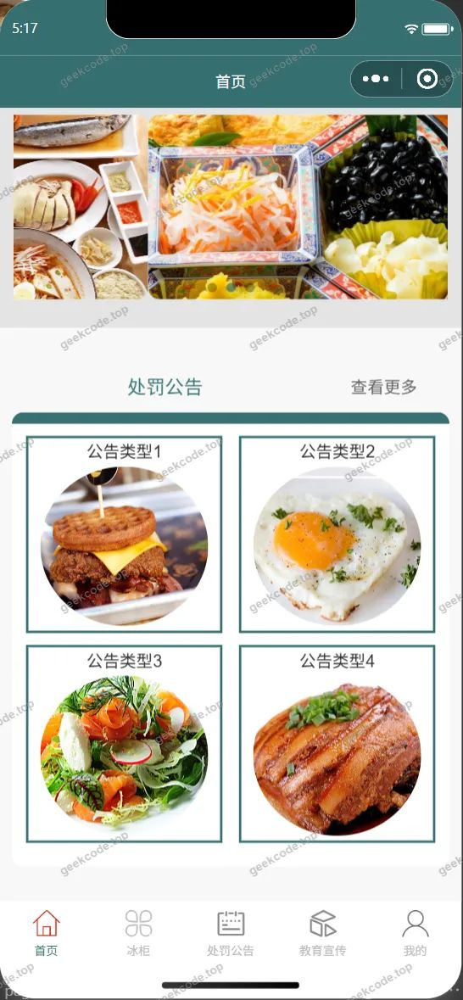</a><figcaption>小程序-首页</figcaption></figure>
<figure><a href="https://geekcode.top/archives/%E5%9F%BA%E4%BA%8E%E5%BE%AE%E4%BF%A1%E5%B0%8F%E7%A8%8B%E5%BA%8F%E7%9A%84%E9%AB%98%E6%A0%A1%E9%A4%90%E5%8E%85%E9%A3%9F%E5%93%81%E7%95%99%E6%A0%B7%E7%AE%A1%E7%90%86%E7%B3%BB%E7%BB%9F?utm_source=github" title="查看完整源码">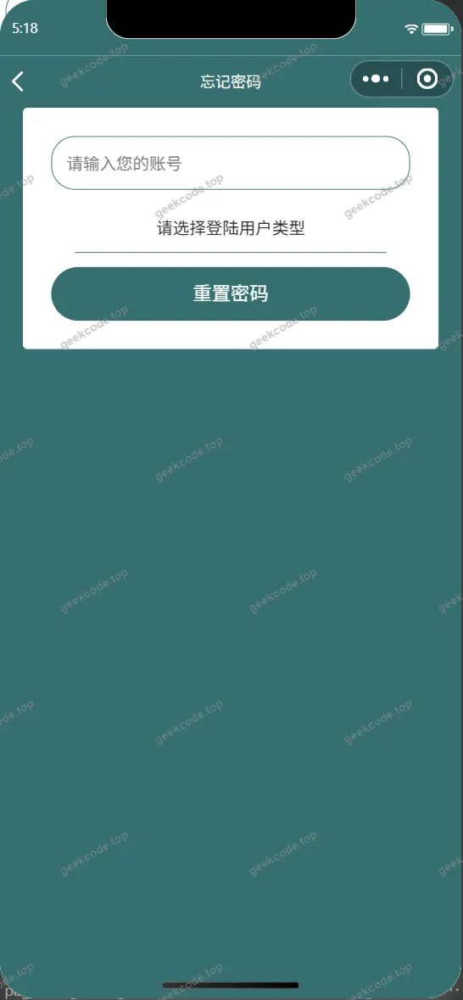</a><figcaption>小程序-忘记密码</figcaption></figure>
<figure><a href="https://geekcode.top/archives/%E5%9F%BA%E4%BA%8E%E5%BE%AE%E4%BF%A1%E5%B0%8F%E7%A8%8B%E5%BA%8F%E7%9A%84%E9%AB%98%E6%A0%A1%E9%A4%90%E5%8E%85%E9%A3%9F%E5%93%81%E7%95%99%E6%A0%B7%E7%AE%A1%E7%90%86%E7%B3%BB%E7%BB%9F?utm_source=github" title="查看完整源码">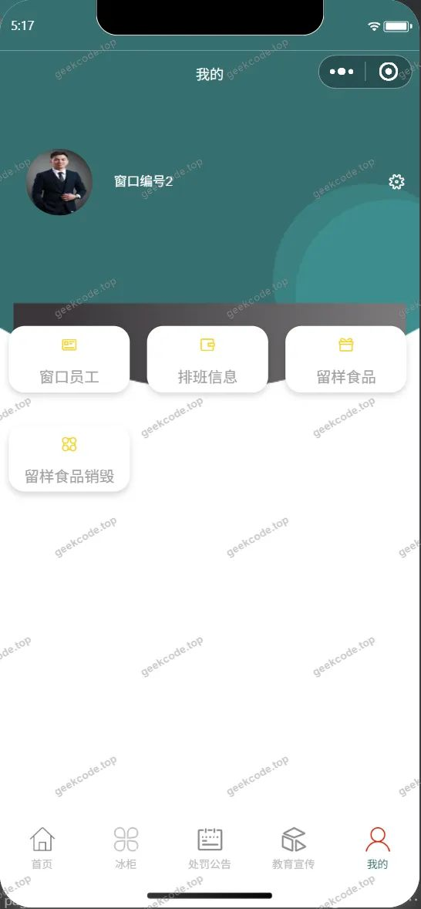</a><figcaption>小程序-我的</figcaption></figure>
<figure><a href="https://geekcode.top/archives/%E5%9F%BA%E4%BA%8E%E5%BE%AE%E4%BF%A1%E5%B0%8F%E7%A8%8B%E5%BA%8F%E7%9A%84%E9%AB%98%E6%A0%A1%E9%A4%90%E5%8E%85%E9%A3%9F%E5%93%81%E7%95%99%E6%A0%B7%E7%AE%A1%E7%90%86%E7%B3%BB%E7%BB%9F?utm_source=github" title="查看完整源码">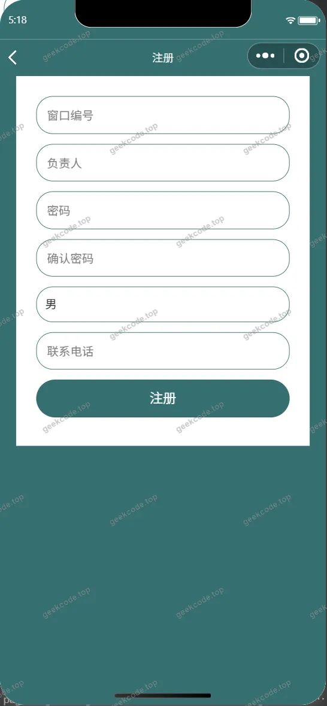</a><figcaption>小程序-注册</figcaption></figure>

<h3>微信小程序管理端</h3>

<figure><figcaption>小程序-管理端-窗口负责人列表</figcaption></figure>
<figure><figcaption>小程序-管理端-窗口负责人详情</figcaption></figure>

<h3>后台管理端</h3>
<h4>后台-处罚公告</h4>

<a href="https://geekcode.top/archives/%E5%9F%BA%E4%BA%8E%E5%BE%AE%E4%BF%A1%E5%B0%8F%E7%A8%8B%E5%BA%8F%E7%9A%84%E9%AB%98%E6%A0%A1%E9%A4%90%E5%8E%85%E9%A3%9F%E5%93%81%E7%95%99%E6%A0%B7%E7%AE%A1%E7%90%86%E7%B3%BB%E7%BB%9F?utm_source=github" title="查看完整源码">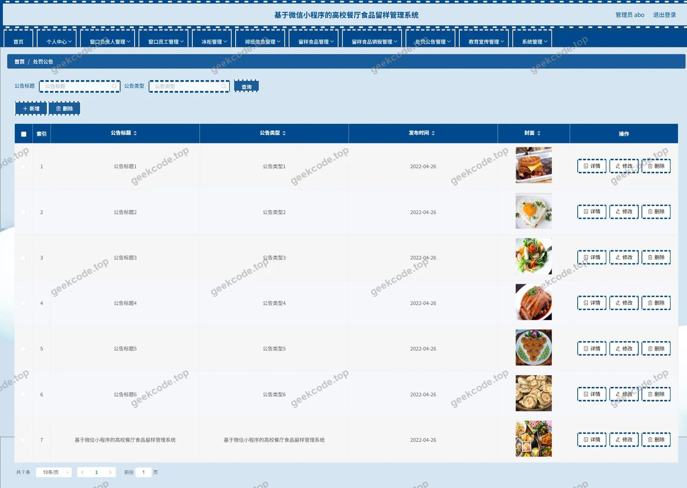</a>

<h4>后台-窗口负责人</h4>

<a href="https://geekcode.top/archives/%E5%9F%BA%E4%BA%8E%E5%BE%AE%E4%BF%A1%E5%B0%8F%E7%A8%8B%E5%BA%8F%E7%9A%84%E9%AB%98%E6%A0%A1%E9%A4%90%E5%8E%85%E9%A3%9F%E5%93%81%E7%95%99%E6%A0%B7%E7%AE%A1%E7%90%86%E7%B3%BB%E7%BB%9F?utm_source=github" title="查看完整源码">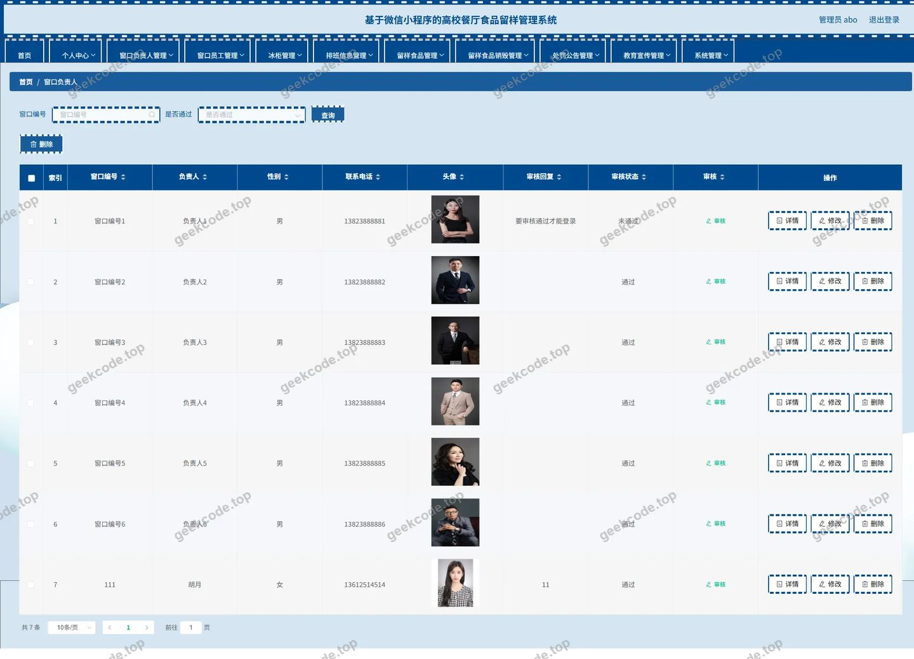</a>

<h4>后台-登录页</h4>

<a href="https://geekcode.top/archives/%E5%9F%BA%E4%BA%8E%E5%BE%AE%E4%BF%A1%E5%B0%8F%E7%A8%8B%E5%BA%8F%E7%9A%84%E9%AB%98%E6%A0%A1%E9%A4%90%E5%8E%85%E9%A3%9F%E5%93%81%E7%95%99%E6%A0%B7%E7%AE%A1%E7%90%86%E7%B3%BB%E7%BB%9F?utm_source=github" title="查看完整源码">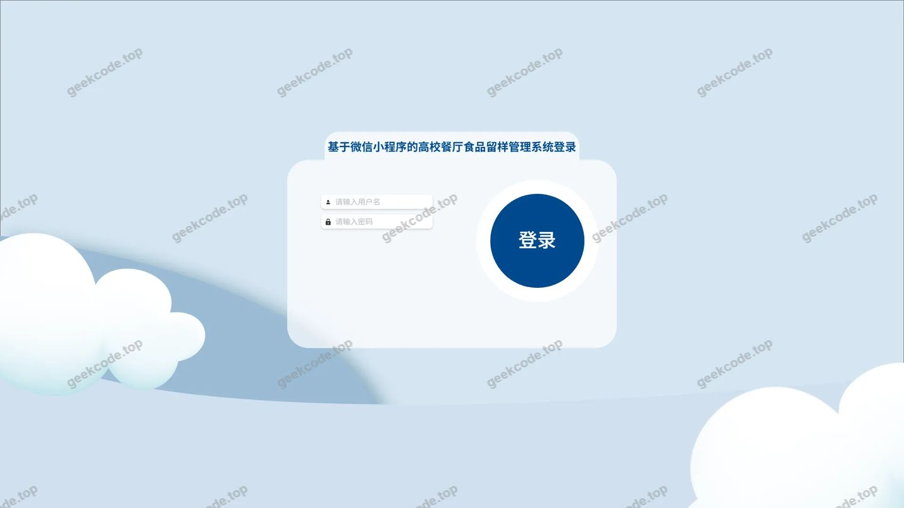</a>

<h4>后台-教育宣传</h4>

<a href="https://geekcode.top/archives/%E5%9F%BA%E4%BA%8E%E5%BE%AE%E4%BF%A1%E5%B0%8F%E7%A8%8B%E5%BA%8F%E7%9A%84%E9%AB%98%E6%A0%A1%E9%A4%90%E5%8E%85%E9%A3%9F%E5%93%81%E7%95%99%E6%A0%B7%E7%AE%A1%E7%90%86%E7%B3%BB%E7%BB%9F?utm_source=github" title="查看完整源码">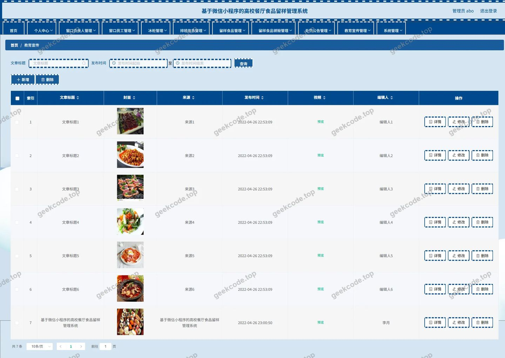</a>

<h4>后台-留样食品</h4>

<a href="https://geekcode.top/archives/%E5%9F%BA%E4%BA%8E%E5%BE%AE%E4%BF%A1%E5%B0%8F%E7%A8%8B%E5%BA%8F%E7%9A%84%E9%AB%98%E6%A0%A1%E9%A4%90%E5%8E%85%E9%A3%9F%E5%93%81%E7%95%99%E6%A0%B7%E7%AE%A1%E7%90%86%E7%B3%BB%E7%BB%9F?utm_source=github" title="查看完整源码">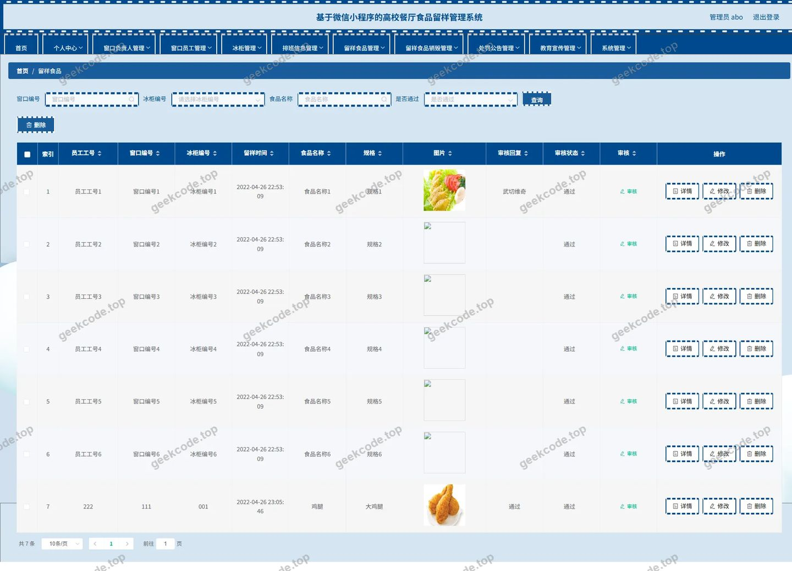</a>

<h4>后台-留样食品销毁</h4>

<a href="https://geekcode.top/archives/%E5%9F%BA%E4%BA%8E%E5%BE%AE%E4%BF%A1%E5%B0%8F%E7%A8%8B%E5%BA%8F%E7%9A%84%E9%AB%98%E6%A0%A1%E9%A4%90%E5%8E%85%E9%A3%9F%E5%93%81%E7%95%99%E6%A0%B7%E7%AE%A1%E7%90%86%E7%B3%BB%E7%BB%9F?utm_source=github" title="查看完整源码">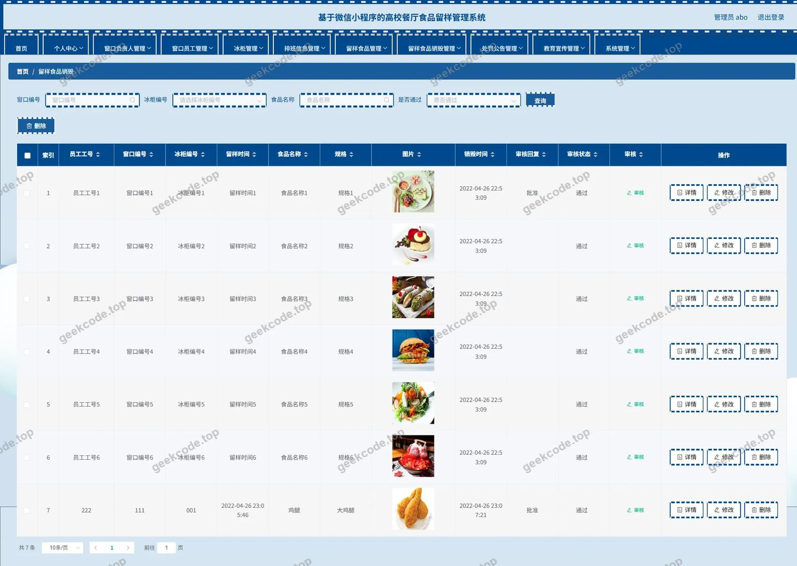</a>

<h4>后台-排班信息</h4>

<a href="https://geekcode.top/archives/%E5%9F%BA%E4%BA%8E%E5%BE%AE%E4%BF%A1%E5%B0%8F%E7%A8%8B%E5%BA%8F%E7%9A%84%E9%AB%98%E6%A0%A1%E9%A4%90%E5%8E%85%E9%A3%9F%E5%93%81%E7%95%99%E6%A0%B7%E7%AE%A1%E7%90%86%E7%B3%BB%E7%BB%9F?utm_source=github" title="查看完整源码">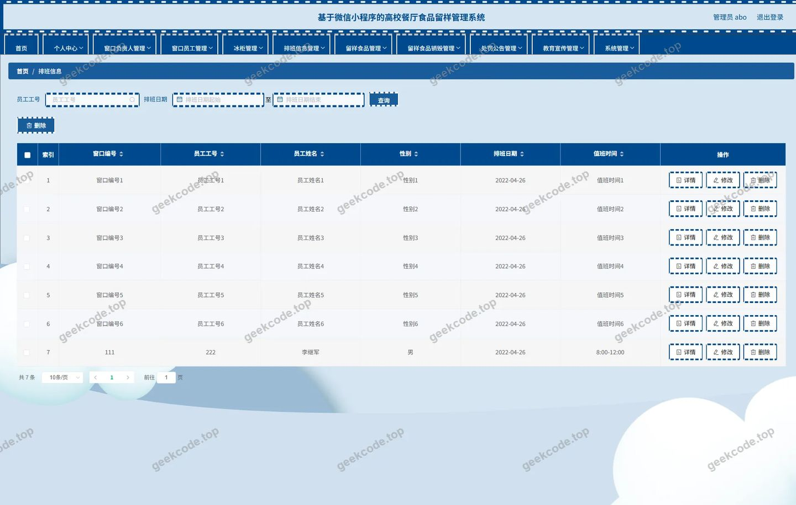</a>

<h4>后台首页</h4>

<a href="https://geekcode.top/archives/%E5%9F%BA%E4%BA%8E%E5%BE%AE%E4%BF%A1%E5%B0%8F%E7%A8%8B%E5%BA%8F%E7%9A%84%E9%AB%98%E6%A0%A1%E9%A4%90%E5%8E%85%E9%A3%9F%E5%93%81%E7%95%99%E6%A0%B7%E7%AE%A1%E7%90%86%E7%B3%BB%E7%BB%9F?utm_source=github" title="查看完整源码">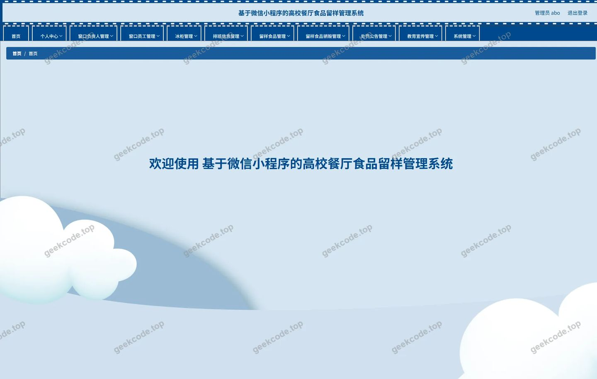</a>

---

## 获取完整源码

| 项目 | 说明 |
| --- | --- |
| 项目名 | 基于微信小程序的高校餐厅食品留样管理系统 |
| 运行截图 | 本文 30 张（站点带水印原图，仓库 `images/` 目录） |
| 完整源码 | [https://geekcode.top/archives/%E5%9F%BA%E4%BA%8E%E5%BE%AE%E4%BF%A1%E5%B0%8F%E7%A8%8B%E5%BA%8F%E7%9A%84%E9%AB%98%E6%A0%A1%E9%A4%90%E5%8E%85%E9%A3%9F%E5%93%81%E7%95%99%E6%A0%B7%E7%AE%A1%E7%90%86%E7%B3%BB%E7%BB%9F?utm_source=github](https://geekcode.top/archives/%E5%9F%BA%E4%BA%8E%E5%BE%AE%E4%BF%A1%E5%B0%8F%E7%A8%8B%E5%BA%8F%E7%9A%84%E9%AB%98%E6%A0%A1%E9%A4%90%E5%8E%85%E9%A3%9F%E5%93%81%E7%95%99%E6%A0%B7%E7%AE%A1%E7%90%86%E7%B3%BB%E7%BB%9F?utm_source=github) |
| 咨询微信 | **ir9372**（备注：jingpin-yuanma） |
| 更多项目 | [极客代码 geekcode.top](https://geekcode.top/?utm_source=github) |

> 需要源码、部署、改配置、跑不起来等问题，加微信 ir9372 沟通，说明项目名即可。
